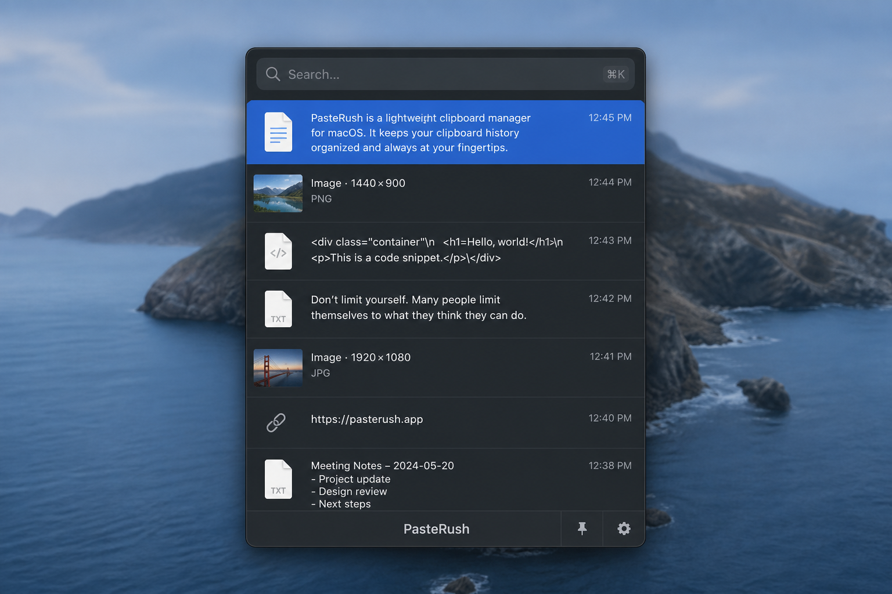
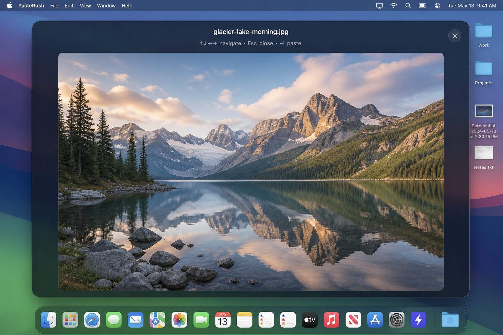
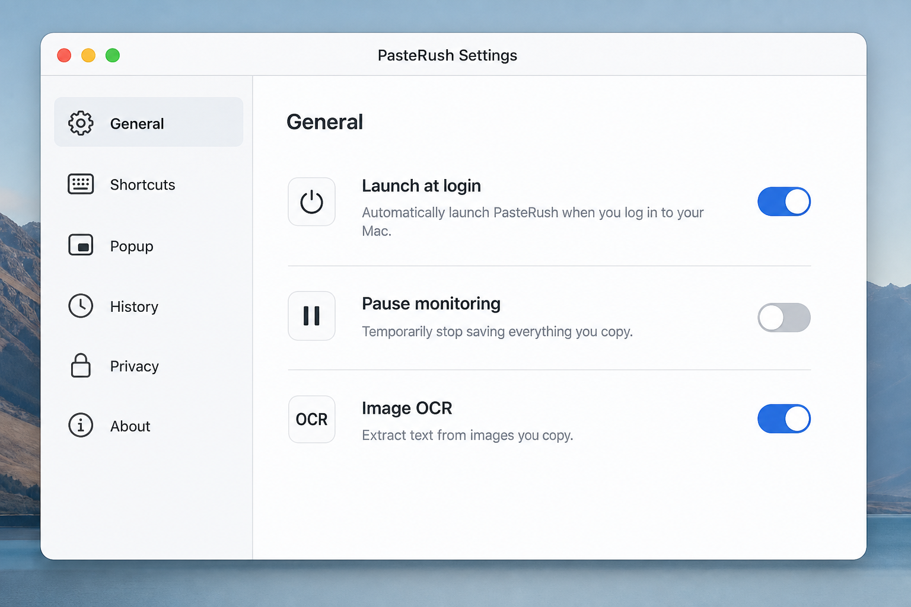

# PasteRush

**Local clipboard history for macOS** — fast search, image preview, and privacy by default. No account. No cloud. No telemetry.

<p align="center">
  
</p>

<p align="center">
  <a href="https://github.com/fabianszymczak1-cloud/PasteRush/releases/latest"></a>
  <a href="https://buymeacoffee.com/5r8nffw85nw"></a>
  
  
</p>

## Download

**[Download PasteRush.dmg](https://github.com/fabianszymczak1-cloud/PasteRush/releases/latest/download/PasteRush.dmg)** (latest release)

If PasteRush helps you, you can support development here:

**[Buy Me a Coffee](https://buymeacoffee.com/5r8nffw85nw)**

## Features

| | |
|---|---|
| **Clipboard history** | Text, RTF/HTML, images, and files — stored only on your Mac |
| **Instant search** | SQLite FTS5 with filters (`type:`, `app:`, `pinned:`, dates) |
| **Large preview** | Space / ⌥Space for a nearly fullscreen media viewer; ←→ navigate |
| **Smart paste** | Enter pastes into the previous app (Accessibility) |
| **Pins & groups** | Keep important clips forever; organize with groups |
| **Transforms** | Paste special: case changes, slug, UUID, join multiple clips… |
| **Private by design** | No telemetry, no account, optional private mode & excluded apps |
| **Auto-updates** | Sparkle checks GitHub Releases for new versions |
| **EN + PL** | Follows your macOS system language |

<p align="center">
  
  &nbsp;
  
</p>

## Install

1. Download the DMG and drag **PasteRush** to **Applications**.
2. Open the app (menu bar clipboard icon).
3. Grant **Accessibility** when onboarding asks (needed for auto-paste).
4. Copy something → press **⌃`** (Control + backtick) → type → **Enter**.

### Gatekeeper note

This build is ad-hoc signed (no paid Apple Developer ID yet). On first open macOS may block it:

1. System Settings → **Privacy & Security** → **Open Anyway**, or  
2. Terminal: `xattr -dr com.apple.quarantine /Applications/PasteRush.app`

You only need this once. After that, **Sparkle** can install updates from GitHub Releases.

## Keyboard shortcuts

| Shortcut | Action |
|----------|--------|
| ⌃` (configurable) | Open history |
| ↵ | Paste |
| ⇧↵ | Paste as plain text |
| ⌘↵ | Copy only |
| ⌥↵ | Properties |
| ␣ / ⌥␣ | Large preview |
| ↑↓←→ | Navigate (also in preview) |
| Esc | Close preview / popup |
| ⌘P | Pin · ⌘E Edit · ⌘G Groups · ⌘⌫ Delete · ⌘, Settings |

## Support

PasteRush is free. Tips keep the project going:

[](https://buymeacoffee.com/5r8nffw85nw)

## Build from source

```bash
cd PasteRush
export DEVELOPER_DIR=/Library/Developer/CommandLineTools
export SDKROOT=/Library/Developer/CommandLineTools/SDKs/MacOSX.sdk
./Scripts/build_app.sh release
# optional DMG:
./Scripts/make_dmg.sh 1.0.0
cp -R .build/PasteRush.app /Applications/
```

Release (needs `gh` auth + Sparkle private key in `Secrets/`):

```bash
./Scripts/release.sh 1.0.0
```

## License

MIT — see source; contributions welcome.
